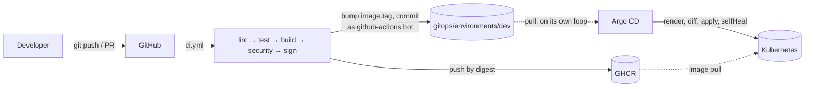

# gitops-cicd-platform

**A production-shaped GitHub Actions → GHCR → Argo CD delivery pipeline for a hardened Go service, with supply-chain security built in, not bolted on.**

[](https://github.com/fakhfakhahmed/gitops-cicd-platform/actions/workflows/ci.yml)
[](LICENSE)
[](app/go.mod)
[](charts/app)
[](gitops/)
[](charts/app/Chart.yaml)

## Why this project exists

Shipping code to production safely means answering three questions on every
single deploy, not just the first one: **can we prove what's running right
now matches a specific, reviewed commit? can we tell, provably, that nobody
tampered with the artifact between build and runtime? and can we undo a bad
deploy in seconds, not minutes, without guessing?**

Most "CI/CD demo" repos stop at "build an image and `kubectl apply` it."
That answers none of the three questions above. This repo is an answer to
all three, end to end: every image is multi-arch built, scanned, SBOM'd and
keylessly signed before it's trusted; every deployment is declared in git
and reconciled by a pull-based control loop (Argo CD) rather than pushed
by a pipeline holding cluster credentials; and every rollback is a
`git revert`, not an archaeology exercise. Production additionally requires
two independent human approvals — a promotion PR and a manual sync — on
top of everything automated for dev and staging.

This is the pipeline I'd actually want standing between my commits and a
real production cluster.

## Architecture



Full diagrams (promotion flow, supply-chain chain) in
[`docs/architecture.md`](docs/architecture.md).

## Key capabilities

| Capability | How it's implemented | File |
|---|---|---|
| Multi-arch builds (amd64 + arm64) | `docker buildx` with QEMU emulation | [`.github/workflows/ci.yml`](.github/workflows/ci.yml) |
| Build cache | GitHub Actions cache backend (`cache-from/to: type=gha`) | [`.github/workflows/ci.yml`](.github/workflows/ci.yml) |
| SBOM generation | SPDX JSON via `anchore/sbom-action`, plus buildx's own embedded SBOM | [`.github/workflows/ci.yml`](.github/workflows/ci.yml) |
| Vulnerability scanning | Trivy image + filesystem scan → SARIF → GitHub Security tab | [`.github/workflows/ci.yml`](.github/workflows/ci.yml) |
| Keyless image signing | cosign + Sigstore Fulcio/Rekor, signed by digest, OIDC-based | [`.github/workflows/ci.yml`](.github/workflows/ci.yml) |
| GitOps pull-based delivery | Argo CD `Application` per environment, reconciling from git | [`gitops/applications/`](gitops/applications/) |
| Drift detection + self-heal | `syncPolicy.automated.selfHeal: true` (dev/staging) | [`gitops/applications/app-dev.yaml`](gitops/applications/app-dev.yaml) |
| Promotion via reviewed PR | `workflow_dispatch` + `peter-evans/create-pull-request` | [`.github/workflows/promote.yml`](.github/workflows/promote.yml) |
| Distroless, non-root runtime | Multi-stage Dockerfile, UID 65532, read-only rootfs | [`app/Dockerfile`](app/Dockerfile) |
| Autoscaling / disruption budgets / isolation | HPA (`autoscaling/v2`), PDB, default-deny NetworkPolicy | [`charts/app/templates/`](charts/app/templates/) |
| Schema-validated Helm values | `values.schema.json`, fails `helm template` on a typo | [`charts/app/values.schema.json`](charts/app/values.schema.json) |
| Rendered-manifest validation | `helm template` piped into `kubeconform -strict` | [`.github/workflows/pr-validation.yml`](.github/workflows/pr-validation.yml) |

## Quickstart

Requires: Docker Desktop (or another Docker daemon), `minikube`, `kubectl`,
`helm`. Windows is the primary host — PowerShell scripts are first-class.

**PowerShell:**

```powershell
scripts/bootstrap.ps1          # minikube + Argo CD + root Application, one shot
scripts/port-forward.ps1       # Argo CD UI on :8080, app on :8081
```

**bash:**

```bash
./scripts/bootstrap.sh
./scripts/port-forward.sh
```

Open `https://localhost:8080` (user `admin`, password printed by
`bootstrap`) and watch `root-app` reconcile `app-dev`. Hit the app itself:

```bash
curl http://localhost:8081/
```

## Repository layout

```
.
├── app/                    Go HTTP service — the thing being delivered, not the point
├── charts/app/             Helm chart: Deployment, HPA, PDB, NetworkPolicy, ServiceMonitor...
├── gitops/
│   ├── bootstrap/          one-time setup: namespaces, Argo CD values, the root Application
│   ├── applications/       one Argo CD Application per environment + the AppProject
│   ├── applicationset/     git-generator pattern for scaling past 3 environments
│   └── environments/       per-environment values.yaml — the actual source of truth
├── .github/
│   ├── workflows/          ci.yml, pr-validation.yml, promote.yml, security-scan.yml, release.yml
│   └── dependabot.yml      keeps every SHA-pinned action current
├── scripts/                cluster-up/down, install-argocd, bootstrap, port-forward, demo (.ps1 + .sh)
└── docs/                   architecture, pipeline, gitops, security, runbook, screenshots
```

## The delivery flow

1. A developer pushes a commit or opens a PR. `pr-validation.yml` lints
   YAML, lints the Helm chart, renders every environment and validates the
   output against the Kubernetes schema with `kubeconform`, and lints the
   PR title for Conventional Commits.
2. On merge to `main`, `ci.yml` runs: `lint` → `test -race` → multi-arch
   `build` (pushed to GHCR by digest) → `security` (Trivy scan + SBOM) →
   `sign` (cosign keyless, by digest).
3. The final `gitops-update` job — the **only** job with write access to the
   repo — rewrites `image.tag` in `gitops/environments/dev/values.yaml` and
   commits as `github-actions[bot]`, with `[skip ci]`.
4. Argo CD, watching that path from inside the cluster, notices the new
   commit on its own reconcile loop and deploys it to `app-dev`. **CI never
   touches the cluster** — this is the push-to-pull handoff that makes it
   GitOps rather than "CD with extra steps."
5. A human runs `promote.yml` to open a PR moving the tag from `dev` to
   `staging` (and later `staging` to `prod`). Merging that PR updates git;
   for `staging`, Argo CD deploys automatically. For `prod`, the
   `Application` has no automated sync policy — a human must run
   `argocd app sync app-prod` after the PR merges. Two gates, by design.

Full stage-by-stage detail: [`docs/pipeline.md`](docs/pipeline.md) ·
[`docs/gitops.md`](docs/gitops.md).

## Skills demonstrated

GitOps · Argo CD (Application, AppProject, ApplicationSet, app-of-apps,
sync waves, selfHeal, manual-sync gates) · GitHub Actions (reusable
pipelines, path filtering, least-privilege `permissions:`, concurrency
control, SHA-pinned actions) · Docker multi-stage & multi-arch builds
(buildx, QEMU) · container image supply-chain security (Trivy, SBOM/SPDX,
cosign keyless signing, Sigstore Fulcio/Rekor, SARIF → GitHub Security) ·
Helm chart authoring (`values.schema.json`, helpers, `NOTES.txt`, chart
tests) · Kubernetes workload hardening (distroless, non-root,
read-only rootfs, seccomp, dropped capabilities, NetworkPolicy, PDB, HPA,
topology spread) · Prometheus instrumentation (`client_golang`,
ServiceMonitor) · Go (structured concurrency, graceful shutdown, `slog`,
table-driven tests, race detector) · Conventional Commits & automated
changelogs · Infrastructure-as-code validation (`kubeconform`, `kube-linter`,
Checkov, `yamllint`) · PowerShell & Bash automation authored in parallel for
a Windows-first, cross-platform workflow.

## Screenshots

See [`docs/screenshots/README.md`](docs/screenshots/README.md) for the exact
shot list (Argo CD app tree, GitHub Actions run graph, Security tab, and the
app's `/` endpoint proving the deployed commit SHA) — captured after running
`scripts/demo.ps1`.

## What I'd do next in production

- **Argo Rollouts canary/blue-green** instead of a plain rolling update, with
  automated analysis against Prometheus metrics before promoting a canary.
- **external-secrets** (or Sealed Secrets) so no secret ever needs to be a
  plain Kubernetes `Secret` committed anywhere, including in Argo CD's own
  config.
- **Kyverno `ImageVerify` policies** enforcing admission-time signature
  verification — today this pipeline *proves* an image was signed;
  admission-time verification would *require* it before the image can run.
- **Multi-cluster `ApplicationSet`** (cluster generator) once this grows
  past one cluster per environment.
- **Cost controls**: Goldilocks/VPA recommendations feeding back into the
  `resources` block per environment, and a cost-allocation label strategy
  alongside the existing `app.kubernetes.io/*` labels.

## Author

**Ahmed Fakhfakh** — DevOps / Platform Engineer
[GitHub @fakhfakhahmed](https://github.com/fakhfakhahmed)

See also: [`LEARN.md`](LEARN.md) for the concepts behind every design
decision in this repo, written as an interview-prep companion.
