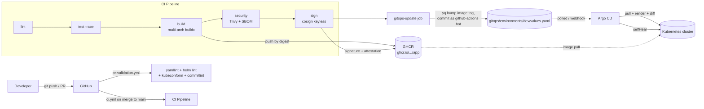
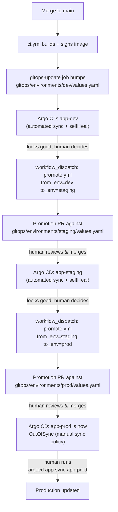
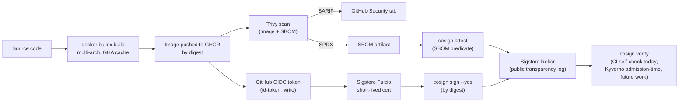

# Architecture

Three diagrams: the end-to-end delivery flow, the environment promotion
flow, and the supply-chain security chain. Each is referenced from
[`README.md`](../README.md); this document is where the detail lives.

## End-to-end delivery flow

The arrow that matters most is the dotted one from the GitOps repo into Argo
CD: CI's job ends at a git commit. Nothing in `ci.yml` holds a kubeconfig,
calls `kubectl`, or calls the Argo CD API. See
[`gitops.md`](gitops.md) for why that split is the entire point of GitOps.

## Environment promotion flow

Two human checkpoints stand between "an image exists" and "production is
running it": the promotion PR's review, and the manual `argocd app sync`.
Dev gets neither — it is meant to move as fast as CI can push it.

## Supply-chain security chain

No private key exists anywhere in this chain for an attacker to steal —
every signature is backed by a certificate that is valid for minutes and
bound to the exact workflow run that produced it, which Rekor records
publicly and permanently. See [`security.md`](security.md) for the full
write-up, including what admission-time verification would add on top of
this.
